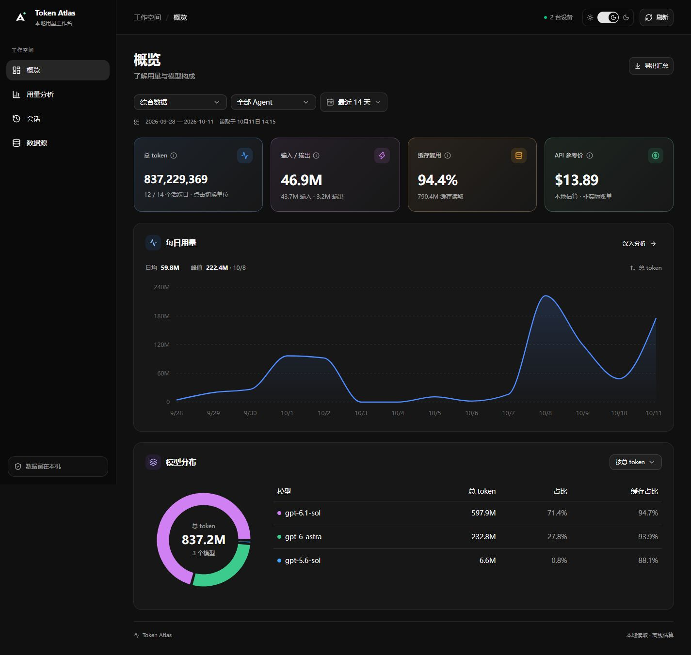
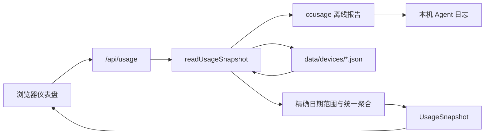

# Token Atlas

<p align="center">
  
</p>

<p align="center">
  一个以隐私为先的本地仪表盘：把 ccusage 可读取的 AI 编程 Agent 用量、缓存、模型与多设备汇总放到同一视图中。
</p>

<p align="center">
  <a href="https://github.com/DonsonHH/Token-Atlas/actions"></a>
  
  
  
</p>



## 它解决什么问题

Token Atlas 只在你的机器上读取 ccusage 的离线汇总。它适合同时使用多种 Agent、在 Windows 与 Ubuntu / Jetson 之间切换，或希望长期观察 token 规模、缓存复用和模型结构的个人开发者。

它不上传会话正文，也不需要 API Key。浏览器仅请求本地服务；外部设备只通过你主动复制或导入的 JSON 汇总参与统计。

| 你想知道           | Token Atlas 提供的答案                                             |
| ------------------ | ------------------------------------------------------------------ |
| 总共用了多少？     | 概览：精确 token / 紧凑单位切换、输入输出、缓存占比和 API 参考价。 |
| 用量何时发生变化？ | 用量分析：日、周、月趋势，按总量或模型拆分，查看和导出周期明细。   |
| 哪次会话消耗较多？ | 会话：搜索、模型筛选、排序、分页、详情与结果导出。                 |
| 外部设备更新了吗？ | 数据源：逐台查看覆盖日期、导出时间，并直接粘贴或上传 JSON。        |

## 支持的 Agent 与数据范围

Token Atlas 使用 ccusage 的离线报告。界面可按已识别来源筛选 Claude Code、OpenAI Codex、OpenCode、Amp、Droid、Codebuff、Hermes、pi、Goose、OpenClaw、Kilo、Kimi、Qwen、GitHub Copilot CLI、Gemini CLI、Antigravity、Grok 与 ZCode。

可用来源取决于本机实际日志。导入表单和命令行脚本优先使用报告中已有的来源；没有来源元数据的旧报告默认按 Codex 处理，导入其他 Agent 时请显式选择真实来源。

## 核心功能

- 概览依次展示四个紧凑 KPI、每日面积图与模型环图 / 数据表。
- 总 token 默认显示完整整数；点击数字即可在精确数值与 `4.4B` 这类紧凑单位之间切换。
- 日期支持 7 / 14 / 30 天、全部日期和自定义范围；全部日期读取所有可用历史，自定义窗口单次最多 366 天。
- 平滑面积图保留前五模型、其他模型和未归类用量，从少到多堆叠；点击图例可以突出一个系列。
- 周、月汇总与会话读取使用同一日期范围；7 日均值按所选指标和连续自然日计算。
- 页面、日期、设备、Agent 和分析选项保存在 URL 中，刷新或前进 / 后退可恢复。
- 会话只来自本机，手机端显示为卡片。搜索后的导出仅包含匹配记录。
- 采用浅色 / 深色主题；刷新、导入、导出和复制通过 Sonner 显示简短反馈。
- 单一 Agent 筛选不会把无法拆分的混合来源导入文件当作该 Agent 的用量。
- 缺少价格的用量显示“待定价”；部分缺价的汇总显示 `≥` 已定价小计，费用曲线留空，不把未知价格画成零费用。

## 快速开始

### 前置条件

- Node.js 20.9 或更高版本。
- pnpm 10 或更高版本；推荐通过 Corepack 启用。
- 如需分析本机数据，至少有一种受 ccusage 支持的 Agent 日志。

```powershell
git clone https://github.com/DonsonHH/Token-Atlas.git
cd Token-Atlas\ccusage-dashboard

corepack enable
pnpm install
pnpm dev
```

打开 <http://localhost:3000> 即可查看仪表盘。

### Windows 一键启动

首次安装依赖后，可在 `ccusage-dashboard` 目录执行：

```powershell
.\scripts\open-dashboard.ps1
```

脚本会检查本地服务；服务未运行时会后台启动，再打开浏览器。依赖升级后只需重新执行一次 `pnpm install`。

## 从 Ubuntu / Jetson 导入数据

外部设备导入的是按日聚合用量，不包含会话正文。最省事的方式是：在 Ubuntu / Jetson 生成并打开 JSON，复制全部内容，然后在 Windows 端从剪贴板导入。

### 1. 在 Ubuntu 或 Jetson 导出

将 `ccusage-dashboard/scripts/export-jetson-usage.sh` 复制到设备后执行：

```bash
bash export-jetson-usage.sh
```

它默认导出全部可用日期的 Codex 数据并打开文件。脚本使用与网页相同的 ccusage `20.0.30`；若已安装版本不同，会依次尝试 `pnpm dlx`、`npx` 运行该版本，以免继续使用旧价格表。只安装 Node.js 的 Ubuntu 也可以使用。

如需指定文件、设备名称或来源：

```bash
bash export-jetson-usage.sh ~/jetson-usage.json "NVIDIA Jetson Orin Nano" codex
```

将最后一个参数改为 `all`，可导出 ccusage 识别到的全部来源。

### 2. 在网页导入（推荐）

打开 **数据源 → 导入数据**，粘贴 JSON 或选择文件（最大 5 MB），确认设备名称和 Agent 来源后导入。更新同一设备时，在对应卡片选择 **更新数据**，避免把同一份日志重复计入不同设备。

导入前会检查日期和数值，拒绝多设备合并导出文件。更新以临时文件原子替换，并把上一份保存为 `data/devices/<id>.bak`。导入只保存用量字段，不保存对话内容。外部数据已经按日聚合，使用导出端的日期口径；要精确比较两台设备，请在 ccusage 导出时使用相同的时区。

### 3. 在命令行导入（兼容原工作流）

复制 JSON 全文后，在 `ccusage-dashboard` 目录运行：

```powershell
.\scripts\import-usage.ps1
```

脚本与网页复用同一校验器，剔除正文及无关字段，补齐设备与来源元数据，并以原子方式写入 `data/devices/jetson-orin-nano.json`。首次运行前需执行 `pnpm install`；不需要提前启动网页服务。回到页面点击“刷新”，再选择“综合数据”或该设备即可查看。

已有文件可直接导入，也可指定来源：

```powershell
.\scripts\import-usage.ps1 -Source codex -InputPath C:\path\to\jetson-usage.json
```

`data/devices/*.json` 默认被 Git 忽略。请不要提交自己的用量导出文件。

## 隐私与数据说明

Token Atlas 处理的是 ccusage 输出中的日期、token、模型、会话目录、活跃时间和本地成本估算。它不会上传、展示或复制会话正文。

“API 参考价”来自 ccusage 的离线定价表，仅用于观察趋势；它不是服务商账单、额度或 credits。当前读取器固定为 ccusage `20.0.30`。新模型仍可能缺价，此时页面保留诊断信息：完全缺价显示“待定价”，部分缺价显示已定价小计，图表对缺价日期留空；没有用量的自然日仍显示零。旧报告中有 token 却没有价格的记录显示为未确认价格，而非确认免费。

导入的是导出时的汇总，升级本机读取器不会重新计算另一台设备的旧成本；请在原设备使用新版脚本重新导出，再更新对应数据源。只有具备可靠价格来源时，才应使用 ccusage 的 [`pricingOverrides`](https://ccusage.com/guide/config-files) 配置覆盖单模型价格。

推理输出包含在输出 token 中，不重复累加。导出在浏览器本地完成，导入文件也只保留在你的设备上。

## 架构

页面通过 `/api/usage` 读取当前范围；`/api/import` 接收同源的本地 JSON 导入。数据读取、日期口径、统计推导和页面渲染分别维护。



| 模块                          | 职责                                                   |
| ----------------------------- | ------------------------------------------------------ |
| `lib/usage-range.ts`          | 日期、时区与范围校验                                   |
| `lib/usage.ts`                | ccusage 读取编排                                       |
| `lib/usage-snapshot.ts`       | 合并本机 / 导入，统一日、周、月与模型汇总              |
| `lib/usage-analytics.ts`      | 补齐日期、按指标求均值、无遗漏模型堆叠                 |
| `lib/usage-pricing.ts`        | 区分完整价格、已知小计与未确认价格，统一页面诊断与文案 |
| `hooks/use-usage-snapshot.ts` | 请求取消、范围身份与失败状态                           |
| `components/workspace/`       | 页面外壳、范围控件、四个页面与导入交互                 |

本机读取失败时，仍可使用有效的导入数据，并显式显示数据提示。切换筛选时不展示上一范围的结果。详细审查记录见 [重构 review](docs/redesign-review.md) 与 [价格与读取器复查](docs/pricing-review.md)。

## 开发与验证

在 `ccusage-dashboard` 目录运行：

| 命令             | 用途                                         |
| ---------------- | -------------------------------------------- |
| `pnpm dev`       | 启动开发服务器                               |
| `pnpm lint`      | 执行 ESLint 检查                             |
| `pnpm typecheck` | 执行 TypeScript 严格类型检查                 |
| `pnpm test`      | 运行数据归一化、聚合、设备选择与导出回归测试 |
| `pnpm build`     | 构建生产版本                                 |
| `pnpm verify`    | 依次运行 lint、typecheck、test 和 build      |

GitHub Actions 会在主分支推送与 Pull Request 时，在 Windows 和 Ubuntu 上执行同样的验证。

## 部署

推荐在日志所在机器本地运行。ccusage 需要读取本机 Agent 日志，部署到无状态云平台通常既无法访问数据，也违背本项目的隐私目标。

```powershell
cd ccusage-dashboard
pnpm install
pnpm build
pnpm start
```

如要在受信任局域网查看，可绑定到局域网地址。请仅在防火墙、VPN 或反向代理鉴权已配置的网络中使用，切勿直接将端口暴露到公网。

```bash
pnpm start -- --hostname 0.0.0.0 --port 3000
```

## 故障排查

### 页面没有本机数据

在应用目录运行 `pnpm exec ccusage daily --json --offline`。若没有记录，请确认这台机器已有受支持 Agent 的本地日志，并已完成 `pnpm install`。需要缩小范围时，可添加 `--since YYYY-MM-DD --until YYYY-MM-DD`。

### 导入设备没有显示

确认文件位于 `ccusage-dashboard/data/devices/`，扩展名为 `.json`，根对象中包含非空 `daily` 数组。导入完成后刷新页面，并切换到“综合数据”或目标设备。

### 成本数字与账单不一致

这是预期行为。Token Atlas 展示的是 ccusage 根据本地定价表推导的参考值，不是官方结算金额。

### 有 token，但近期参考价为零或“待定价”

先在数据源页面确认读取器版本，再检查数据提示中的模型名称。老版本可能尚未包含新模型价格，升级网页依赖后刷新：

```powershell
pnpm install
```

本项目已固定新版依赖；如果以后需要升级，请同时更新 `package.json`、锁文件和 Jetson 导出脚本，并运行 `pnpm verify`。外部设备的数据需要在原设备重新导出并导入，不能仅靠刷新本机修复。新版依然缺价时，请核实模型与服务商，再参考 ccusage 的定价覆盖配置；不要自行填入猜测价格。

## 贡献与许可

欢迎提交 Issue 或 Pull Request。提交前请在 `ccusage-dashboard` 目录执行 `pnpm verify`。

项目以 [MIT License](LICENSE) 发布。查看 [Releases](https://github.com/DonsonHH/Token-Atlas/releases) 获取最新版本。
